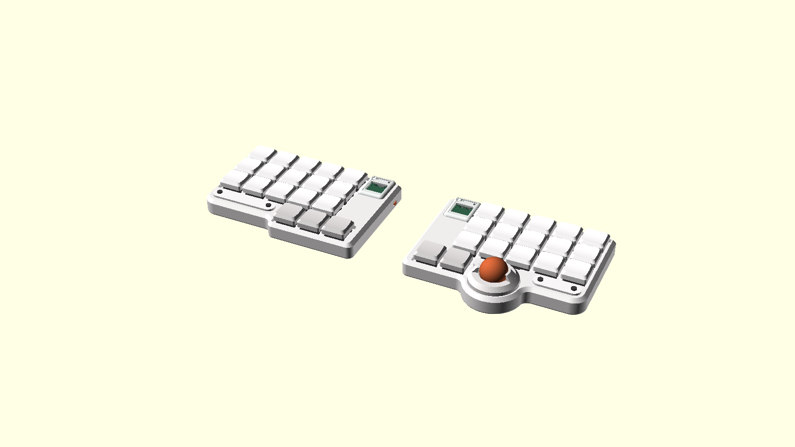
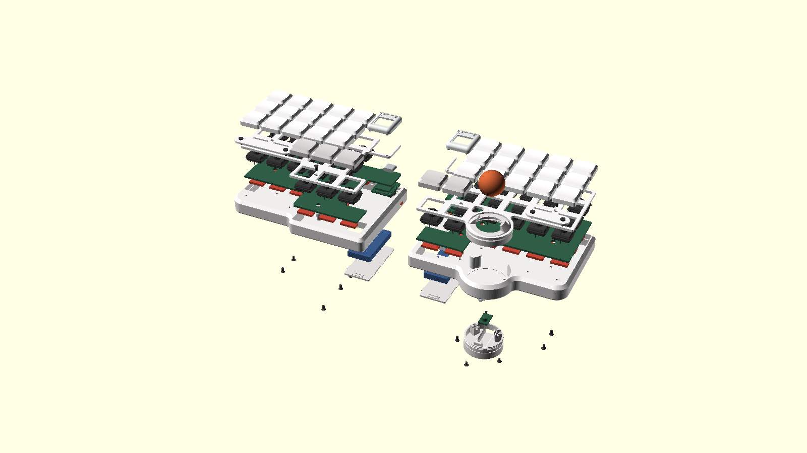

# リポバッテリの左右分割キーボード ケース（たたき台）

35 キー（5列×3段＋親指 左3・右2）・Ø19 トラックボール（ZEN Keyboard の作りをそのまま写した）・単3 ×1 本の左右分割キーボード用ケース。
3D プリントでの試作を前提にした、外形と積み方を確かめるためのたたき台である。

電源はリポバッテリで、XIAO の南の内側の列に入れる。ケースの底は平らで、テントは付けない（2026-10-04）。
マイコン（XIAO）は上面の内側の列の北の端に置き、USB-C を北の面から挿す。

決定案の上面図: https://claude.ai/artifact/QWxB6wJEZTf7pmsB3Z84V6



## 作り方

形は `build.py`（FreeCAD）だけで定義する。寸法を変えるときは `build.py` 冒頭の定数を直し、流し直す。

```sh
/Applications/FreeCAD.app/Contents/Resources/bin/freecadcmd build.py
```

`build.py` は部品を組み、干渉を調べ、STEP と STL を書き出す。干渉があれば最後に一覧を出す。
実部品の参考モデルを読むので、1 回に約 3 分かかる。

## 参考モデル（`ref/`）

キースイッチは `torabo-tsuki-om-case` と同じ部品を使い、同じ参考モデルを `ref/` に置いた。

| 部品 | 実部品 | 参考モデル | ライセンス |
| --- | --- | --- | --- |
| 電池ボックス（**使わなくなった**、2026-10-03） | BH-311-1P24（秋月 g100308） | `BatteryHolder_Keystone_2460_1xAA.step` | Apache-2.0 |
| キースイッチ | **Kailh Choc V2（PG1353）** | `choc-v2-red.step`（koktoh/keyswitch_model） | **CC BY-NC-SA 4.0** |
| マイコン | **Seeed XIAO nRF52840** | `xiao-nrf52840.step`（Seeed Wiki の公開モデル） | **表記なし（再配布しない）** |

- **単3 電池はやめた**（2026-10-04。電源はリポバッテリ）。`ref/BatteryHolder_Keystone_2460_1xAA.step` は `build.py` から読まない。
- **Choc V2 の干渉は外形図 CPG135301D03 の包絡（`switch_envelope()`）で判定する。** 下胴 13.95 角 × 2.20、ハウジング 15.00 角 × 3.10、ステム 6.50 角で上端 8.60（PCB 上面基準）。公開モデルの外形がこれと合わなければ `build.py` が止まる。
- **`choc-v2-red.step` には NC（非営利）と SA（継承）が付く。** アセンブリに実形状を置くので、条件は `out/` のアセンブリ STEP・STL にも及ぶ。配布するときは出典と CC BY-NC-SA 4.0 を明示する。商用で使うなら `ref/choc-v2-red.step` を消す。`build.py` は包絡で代えて動く。
- **`xiao-nrf52840.step` はライセンスが分からない。** 公開するときは消し、入手先（`ref/xiao-nrf52840.LICENSE.txt`）だけ残す。`build.py` は外形の箱で代えて動く。
- 参考モデルが無いときは、どれも包絡で代えて動く。
- `out/stl/asm/` の参考モデル（スイッチ・XIAO）は粗く割る（`COARSE_STL`）。細かく割るとスイッチだけで片手 200MB になる。

画像と色付き 3MF は、書き出した STL を `preview.scad` で並べて作る。`preview.scad` は形を持たない。

```sh
openscad --backend=manifold -D 'view="assembled"' -o out/assembly-assembled.3mf preview.scad
openscad --backend=manifold -D 'view="exploded"'  -o out/assembly-exploded.3mf  preview.scad
openscad --backend=manifold --imgsize=1600,900 -D 'view="assembled"' -o img/assembled.png preview.scad
openscad --backend=manifold --imgsize=1600,900 -D 'view="exploded"'  -o img/exploded.png  preview.scad
```

画像はカメラを指定しない（OpenSCAD の既定の視点）。

配色違いの画像は `scheme`（`black`・`white`・`darkgray`）で書き出す。ケース・プレート・カバー・タグ・キーキャップ・ボールのカバーなど、外から見える部品の色をそろえる。基板・ネジ・ボールは元の色のまま。タグとマイコンカバーだけ別の色にするときは `accent`（例 `-D 'accent="#C45E35"'`）を渡す。

```sh
for s in black white darkgray; do
  openscad --backend=manifold --imgsize=1600,900 --colorscheme=Tomorrow -D 'view="assembled"' -D "scheme=\"$s\"" -o img/assembled-$s.png preview.scad
done
```

## 出力

### STEP（`out/step/`）

| ファイル | 内容 | 外形（mm） |
| --- | --- | --- |
| `case-left.step` / `case-right.step` | ケース（**アルミの CNC で発注する**。底が平らなトレイ。壁と上面でスイッチを隠す） | 124.4 × 85.1 × 12.6 ／ 124.4 × 99.6 × 12.6 |
| `ball-base-right.step` | ボールの台（ZEN の PAW3222 用の台を円にし、カバーをねじ込む筒を足した形。φ31、床の上に置く。センサーの溝、柱 3 本にベアリングを φ1.5 のピンで留める） | 31.0 × 31.0 × 14.0 |
| `plate-left.step` / `plate-right.step` | トッププレート（厚さ 2.0、外周はキーキャップの外周。XIAO の窓つき） | 116.1 × 78.6 × 2.0 ／ 116.0 × 92.6 × 2.0 |
| `tag-left.step` / `tag-right.step` | タグ（ケースの上面に載せる、両端が半円の板） | 50.5 × 10.0 × 1.5 ／ 32.6 × 10.0 × 1.5 |
| `cover-left.step` / `cover-right.step` | マイコンカバー（磁石で外せる。リセットボタン・LED の穴つき） | 20.5 × 25.2 × 4.8 |
| `battery-door-left.step` / `battery-door-right.step` | リポバッテリのふた（底の座にはめてスライドで留める。爪と抜け止めの舌つき） | 24.2 × 48.6 × 1.9（爪・突起込み） |
| `slider-left.step` / `slider-right.step` | 電源スイッチのスライダー（壁の窓から外へ出る） | 8.1 × 8.1 × 3.3 |
| `ball-ring.step` | ボールのカバー（ZEN のカバーの写し。台のねじの筒にねじ込み、東西の爪でボールを押さえる） | 34.0 × 34.0 × 11.7 |
| `assembly.step` | 左右を組んだアセンブリ（部品ごとに名前付き、約 60MB） | 287.2 × 100.7 × 28.8 |

部品単体の STEP はアセンブリ座標のまま書き出す（左右それぞれ自分の原点）。
アセンブリにはスイッチ・XIAO の参考モデルと、PCB・ホットスワップソケット・キーキャップ・リポバッテリ・ボール・ベアリング・センサー・スペーサー・ネジの簡略形状も入る。

### STL（`out/stl/`）

印刷向きの部品。ケースはアルミの CNC で発注するので、発注には STEP（`out/step/case-*.step`）を使う。STL は確認用で、平らな底が下、ボールの台は平らな底が下（アセンブリの向きのまま）、プレートとタグは上面が上、リポバッテリのふたは平らな板のまま（アセンブリの向き）、マイコンカバーは天面を造形台に伏せた向き、電源スイッチのスライダーはアセンブリの向きのまま（平らな下面が下）、ボールのカバーは筒の下端を造形台に置いた向き（口の下面は張り出しになる）。
ケースの底は平らで、机にそのまま置く（テントはやめた。2026-10-04）。
`out/stl/asm/` はアセンブリ座標の全部品で、`preview.scad` が読む。

### 3MF と画像

| ファイル | 内容 |
| --- | --- |
| `out/assembly-assembled.3mf`・`img/assembled.png` | 組み上げた状態（色付き） |
| `out/assembly-exploded.3mf`・`img/exploded.png` | 層ごとに上下へ離した分解図（色付き） |
| `img/assembled-black.png`・`img/assembled-white.png`・`img/assembled-darkgray.png` | 組み上げた状態の配色違い（黒・白・ダークグレー） |



### Web の 3D ビューア（`web/`）

`out/stl/asm/*.stl` を `export_glb.py` で 1 つの GLB にまとめ、`web/index.html`（three.js）で回して見る。
色・分解図のオフセット・配色違いは `preview.scad` の表を読んで GLB に入れるので、ビューア側に色を書かない。
STEP は three.js で読めず、`assembly.step` は約 70MB あるので使わない。

```sh
python3 export_glb.py                                 # -> web/assembly-local.glb（XIAO 入り・手元用。numpy だけで動く）
python3 export_glb.py --no-xiao -o web/assembly.glb   # -> 公開用（XIAO を抜く）
python3 -m http.server -d web 8765                    # http://localhost:8765/ を開く（8000 は別のサイトが使う）
```

- `index.html` は `assembly-local.glb` があればそれを、無ければ `assembly.glb` を読む。
- `build.py` を流し直したら、`export_glb.py` を 2 通りとも流し直す。

### 公開（GitHub Pages）

`main` に `web/` の変更を push すると、`.github/workflows/pages.yml` が `web/` を GitHub Pages に置く。

- **XIAO を含むものは公開しない。** `ref/xiao-nrf52840.step` は配布元に再配布の条件が書かれていない（2026-11-07 に Seeed Wiki・ライセンスのページ・zip の中身・STEP のヘッダーを確かめた）。
  モデルそのものと、それを含む出力（`out/stl/asm/xiao-*.stl`・`out/step/assembly.step`・`out/*.3mf`・`web/assembly-local.glb`）は `.gitignore` に入れてある。
  公開する GLB は必ず `--no-xiao` で作る。
- Kailh Choc V2 のモデルは CC BY-NC-SA 4.0 なので、それを含む `out/` の STEP・STL と `web/assembly.glb` も CC BY-NC-SA 4.0 で配る。出典は `index.html` のフッターに書いてある。
- `.glb` を置けない場所には `--json` で base64 の JSON（`assembly.json`）も書き、`index.html` の隣に置く。
  例: `python3 export_glb.py --no-xiao --json -o web/share/assembly.glb`（`web/share/` は git に入れない）

## 寸法の決め方

- 平面: 決定案の画像を 100px = 19.05mm で換算した。キー中心・リポバッテリ・ボール中心・タグ・ネジ位置は `build.py` 冒頭の定数にある。
- 高さ: `torabo-tsuki-om-case` と同じ積み方にした。床 2.0、床〜PCB 4.2（★ZEN のボールの台が入るよう 2.2 から広げた。2026-10-04）、PCB 1.6、PCB 上面〜プレート上面 2.2（Choc V2 の座面 `SW_LOW_H`）、プレート 2.0（`PLATE_T`）。プレート上面は z = 10.0、ケースの壁の上端と上面は z = 12.6（`CASE_TOP`）。床上面〜プレート下面は 6.0 で、スペーサーの高さと同じ（下記「締結」）。
- **ケースの外枠でスイッチを隠す**（2026-10-04）: トッププレートの外周をキーキャップの外周に合わせて縮め（`top_outline()`。キーキャップ ＋ 0.75 の四角の和を半径 3.0 で閉じ、出隅を R1.0 で丸めた形。2026-10-06 に、角丸の四角を足す作りでキーの間に残っていた 0.13 のくぼみをなくし、外枠の縁をまっすぐにした。同じ日に、北の縁をキーキャップ ＋ 0.75 の線でまっすぐ切りそろえた。以前はカバーの範囲だけ壁の内側まで出ていて、キーの列との間が斜めにつながって見えた。カバーの北の端はケースの浅い切り欠きに座るので、プレートは要らない）、ケースの壁と上面をキーキャップの下面の 0.5 下（`CAP_RIM_GAP`）、z 12.6 まで立ち上げる。ケースの上面にはプレートの外形 ＋ 0.25 の穴を開け、プレートはその穴の底（z 8.0〜10.0）に入る。キーの無い部分（マイコンの列のバッテリの上・タグの帯・外周）はケースの上面で覆われ、押し込んだキーキャップとも当たらない。
  - マイコンカバーとボールのカバーはプレートに座るので、プレートの外形にはカバーの範囲と、ボールのまわり（カバーが座り、円い台が通る半径 17.3 の円）も含める。
  - **組み立て**: プレート・PCB（スイッチ・ソケット・XIAO・電源スイッチごと）・スペーサー・ボールの台は、ケースの上面の穴から入れる。PCB の外形はプレート（ボールのまわりを除く）の穴から 0.3 内側。電源スイッチはつまみの先まで穴に収まるよう内側へ寄せた（`PSW_X` 左 115.4・右 8.9）。`check_interference` は、これらを 4.0・8.0 持ち上げた位置でケースに当たらないことを見る。
  - 以前の、プレートの上に別部品の板（トップフレーム）を重ねる案はやめた。
- キーキャップ: 下面を Choc V2 のハウジング上面（PCB 上面 + 5.30）に置く。仮の形で、高さは `torabo-tsuki-om-case` の RidgeCap に合わせて 5.8。3.2 だとステム上端 8.60 が天面を 0.1 突き抜ける。
  - **形は JezailFunder の LAK に寄せた**（2026-10-06、`keycap()`）。LAK の寸法は公表されていないので、写真と配列図から見立てた。17.5 角（角 R1.5、`CAP_R`）で、側面は下面から 3.6（`CAP_WALL_H`）まで垂直、その上は斜めの肩で各辺 1.5（`CAP_TOP_INSET`）内へ入り、上面（角 R2.0）は前後方向にくぼんだ円柱面（中央の深さ 0.5、`CAP_DISH`）。段ごとの傾きは無い。
- リポバッテリ（2026-10-04。単3 電池の筒とテントはやめた）: **502040**（5.0 × 20 × 40、`LIPO`。2026-10-06 に、北の辺を詰めて XIAO を南へ寄せたので 502045 から縮めた）を、XIAO の南の内側の列（キーの無い帯）に寝かせて入れる。左 x 100.7〜120.7、右 x 3.6〜23.6（x の中心は XIAO にそろえる）、y 24.8〜64.8（`LIPO_Y0`）、z 1.4〜6.4（底のふたの上）。北は XIAO の南の端（y 24.18）、南は親指段の内側のキーの北のピン（キーの中心から北へ 5.5、y 68.55）で決まる。バッテリの南の端〜ピンは 3.75 ある。PCB はバッテリ＋0.3 を切り欠く（`lipo_box()`）。トッププレートは開けない。バッテリの上面〜プレートの下面は 1.6。充電は XIAO nRF52840 が行う。
  - **底から出し入れする**（2026-10-04、電池ぶたの作り）: ケースの床にバッテリ＋0.3 の穴を開け、底から深さ 1.4 の座を掘って、外せる**ふた**（`battery_door()`、別部品、本体 22.6 × 48.6 × 1.4、角 R1）をはめる。ネジは使わない。バッテリはふたの上（z 1.4）に載る。
    - **爪と溝**: ふたの東西の縁に爪 3 つずつ（長さ 5.0、張り出し 0.8、z 0.8〜1.4）。座の東西の壁に、座の天井の高さ（z 0.5〜1.4）の溝を全長に掘り、溝の下の縁（厚さ 0.5）に爪が掛かってふたが抜けない。座は南へ 4.0（`DOOR_SLIDE`）長く、開けた位置の爪の下の縁を抜いた入れ口がある。
    - **付け方**: ふたを南へ 4.0 ずらした位置で、爪を入れ口から差し込み、北へすべらせる。閉めると座の南に 4.0 のすき間が残る。
    - **抜け止め**: ふたの南の端に、西の端でつながった舌（9.0 × 2.0、まわりの切れ目 0.6）があり、先の突起（φ1.4 × 0.5）が閉めた位置で床の穴（φ1.8）にはまる。開けるときは、ふたの裏の滑り止めの溝（3 本）に指を掛けて南へ引く。舌が下へたわんで突起が外れる。
    - `check_interference` は、閉めた位置のほか、南へ 4.0 すべらせた位置と、そこから 1.0 下げた位置でケースに当たらないこと（突起を除く）を見る。閉めた位置で 0.8 下げると爪が溝の縁に当たる（抜けない）ことは手で確かめた。
  - 経緯（2026-10-04）: 352045（PCB の切り欠きに親指段のキーが載り、ピンに当たった）→ 352035 → 内側の北寄りのネジをやめて北へ延ばし、PCB を開けて 502045 → トッププレートの窓はやめ、底のふたから出し入れする形にした（ネジ留め → スライドの電池ぶた）→ 北の辺を詰めて 502040（2026-10-06）。
  - **接点の線**: 穴の両端の近くに、穴から床の上へ抜ける φ2.0 の穴（`WIRE_HOLE_R`）。接点の部品は未定。
- 外形（2026-09-30）: 画像の外形から、北の辺を 0.4（`N_TRIM`）・南の辺を 1.0（`S_TRIM`）だけキー側へ寄せたあと、ネジを外周に置くため全周を 1.5（`GROW`）広げた。外形の辺は `X_W`・`X_E`・`Y_N`・`H_MAIN_L/R`・`H_THUMB`。キー・電池・ボールの位置は画像のまま動かしていない。角は R4.5（`R_CONVEX`）、入り隅は R6.0。
- **ベゼルを詰めた**（2026-10-04）: 外周のネジをやめたので、外側の辺（左は西、右は東）を 3.0（`OUTER_TRIM`、`X_OUT`）、南の辺を 2.5（`S_TRIM` を 1.0 → 3.5）だけキー側へ寄せた。キーキャップの縁から外面までは、外側の辺で約 4.1（左）・4.3（右）、親指段の南で 3.9。内側の辺（XIAO・カバー・リポバッテリの列）は動かさない。
  - **北の辺も詰めた**（2026-10-06）: `N_TRIM` を 0.4 → 3.2 にし、北の辺を 2.8 南へ寄せた（外面 y −1.10 → 1.70）。キーキャップの縁から外面までは 6.9 → 4.1 で、外側の辺とそろう。XIAO は USB-C の先端を北の外面にそろえるので、XIAO とカバーも 2.8 南へ寄り、リポバッテリを 502045 → 502040 に縮めた。
  - キーキャップの端〜プレートの縁は、北 4.17・西 4.38 など、どの辺も 4 以上ある。ネジ頭（φ3.8）がキーキャップから 1.0 以上離れて置ける幅。
  - 左手は親指段だけ `H_THUMB` = 89.3 まで深く、ほかは `H_MAIN_L` = 82.02（画像のとおり）。南西の角にあった XIAO の出っ張り（2026-09-30 の「凹」の形）は、XIAO を移したのでやめた（2026-10-03）。右手も、親指段とボールのふくらみ以外は `H_MAIN_R` = `H_MAIN_L`（82.02）にそろえ、タグの下の余白を左手と同じにした（2026-10-03。以前は `H_THUMB` = 89.3）。
- タグ（2026-10-03 に復活）: 決定案の画像のラベルプレート。3 段目の南の帯に、ケースの上面から載せる厚さ 1.5 の別部品（`TAG`・`TAG_T`・`tag_plate()`）。両端の半円の中心を M2 低頭ネジでケースの上面のめねじへ留める（下記「締結」）。
  - **大きさと位置**（2026-10-06 に縮めた）: 高さ 10.0（`TAG_H`。以前は画像のままの 11.81）、長さは左 50.53・右 32.62。左 x 6.30〜56.83、右 x 85.48〜118.10、y 64.72〜74.72。以前は外側の端と南の端が外周の面取りの縁から 0.25 しか離れていなかった。いまはケースの上面の平らな部分の中で、面取りの縁・上面の穴の縁からどこも 2.3（`TAG_GAP`）離す。キー側の端（左は東、右は西）は以前の位置のまま。
  - **タグのある角**: タグのある角（左は南西、右は南東）を、タグの端の半円と同じ中心の R9.8（`TAG_CORNER_R` = タグの半径 5.0 ＋ 外周の面までの余白 4.8）で丸める（`round_corner()`）。
- 外周の面取り: 45°、幅 2.5 ＝ 壁厚（`CHAMFER_W`・`CHAMFER_H`、`chamfer_band()`）。外周の縁は z = 10.1、上の縁は外形を 2.5 内へ寄せた線の z = 12.6 で、そこから内はケースの平らな上面。外形と、外形を 2.5 内へ寄せた線を直線でつないで作る。
- 底面の縁の R（2026-10-03）: ケースの底の外周の縁を R1.5（`BOTTOM_FILLET`）で丸める（`bottom_body()`）。
- プレートの厚さ 2.0（2026-09-30 に 1.5 から変更）: 上面の高さ（当時 8.0）は Choc V2 の座面で決まっているので動かさず、下面を 0.5 下げた。スペーサーも 4.5 → 4.0 にした（いまは床〜PCB を広げたので 6.0）。
  - **Choc V2 の爪はプレートの裏を加工しない。** 爪（穴の左右の辺の中央、幅 4.0、穴から 0.4 張り出し、PCB 上面から 0.15〜0.55）は、プレート 2.0 の下面（PCB 上面 + 0.20）より高く、公開モデルの上ではプレートに埋まる（1 個あたり 0.64mm³）。実物は 2.0 のプレートにはまることを確かめてある（2026-09-30）ので、そのままにした。干渉チェック「switch-model, plate」は爪の範囲（`clip_boxes()`）だけを除いて見る。
  - **PCB 上面〜プレート下面は 0.20 しか無い。** PCB の上面（スイッチ側）には背の高い部品を置けない。ダイオード・LED などは裏面に置く。
- テント（2026-10-04）: **やめた。** ケースの底は平らで、机にそのまま置く（以前は電池の筒で約 7.8° 付けていた）。
- トラックボール（2026-10-03。2026-10-04 から **ZEN Keyboard の作りをそのまま写す**）: [E24-GH/zen-firmware](https://github.com/E24-GH/zen-firmware/tree/main/3d-models/stl) の v1.3（`zen-trackball-cover`・`zen-trackball-parts-PAW3222`・`zen-topplate-right`・`zen-bottom-right`）の断面から寸法を読み、`build.py` で作った。ボールは **φ19**（ZEN と同じ。[ZEN の説明](https://e24-gh.github.io/zen/)で 19mm±0.1 推奨）。ZEN の STL はリポジトリに入れない（e24 個人利用ライセンス。改変データの再配布も禁止）。**ここで作った形も ZEN の写しなので、配布するときは e24 に確かめる。**
  - **積み方**（ZEN と同じ）: 台は床の上に置き、プレートの下面は台の上面から 0.3 上。このため床上面〜PCB 下面を 2.2 → 4.2 に広げ、ケースの高さは 8.0 → 10.0 になった（2026-10-04）。ZEN は床上面〜プレート下面が 6.3 だが、スペーサーを 6.0 にするため、台を床へ 0.3 沈めた（`BASE_SINK`。台の下の床は 1.7）。
  - **ねじの筒**（`base_collar()`、台と一体）: ★ZEN はプレートの穴のまわりに立ち上がりを付けるが、ここでは台の上面から筒（内半径 14.0・外半径 15.0）を立て、プレートの穴（半径 15.55）を通してプレートの上に 3.0 出す（2026-10-04）。台・筒・ベアリング・カバー・ボールがひとまとまりになり、プレートは穴を開けるだけになる。プレートの上に出る部分の寸法と、外面の丸い山のねじ（断面の半径 0.5、ピッチ 1.33、右ねじ。プレート上面 +0.3 から）は ZEN の立ち上がりと同じ。プレートの穴は、ねじの山の始まり（外半径 15.45）が縁に当たらないよう、筒から 0.55 離す。
  - **カバー**（`ball_ring()`、別部品）: 筒（内半径 15.48・外半径 16.98、プレート上面〜+4.7）の内面に丸い溝のねじで台の筒にねじ込み、反時計回りで外れる。カバーの下端はプレートの上面に座る。筒の上は外面が円すいで細くなり、平らな上面（+7.7、外の縁の半径 14.34）。口は半径 10.1（ボールより 0.6 大きい、+7.2〜+7.7）。口の上の東西に **爪**（幅 ±20.8°、上端 +11.65）が立ち、先が半径 9.3 まで内へ折れて、ボールの赤道より上（中心から 2.1〜2.4 上）を押さえる。外径 φ34.0。
  - **台**（`ball_base()`、別部品。`zen-trackball-parts-PAW3222` の 28 角を円にした）: ★2026-10-04 に円（半径 15.5、`BASE_R`）にした。ねじの筒（外半径 15.0）がそのまま載る。高さ 6.0（z 1.7〜7.7）。床の座（台 + 0.2、深さ 0.3）に置く。上面に PAW3222 の溝（幅 7.8、底は台の底から 1.0、中心の 4.5 南から北の縁へ抜け、上端は 45° × 1.0 の面取り）。柱は PCB の切り欠き（台 + 0.5 の角）・プレートの穴（半径 14.0）を通ってボールの下へ立つ。ZEN と同じ南西（−10.5, +7.5）と北東（+11.5, −7.5）の 2 点を、ケースの底から **M2 × 3 の皿のタッピングネジ**で留める（台の下穴は φ1.8 × 1.5、ZEN と同じ）。
  - **柱とベアリング**: 台の上面から柱 3 本（ZEN の断面 `POST_PROFILE`）。1 本は南、残りは 120° おき。柱は幅 6.0 で、中央に幅 2.6 の溝。ベアリングは **681X（内径 1.5 × 外径 4 × 幅 2）** で、軸は **φ1.5 × 6 のピン**。ピンは柱の両側の半分にある斜めの溝（幅 1.5、鉛直から 30°、上ほどボールの軸へ寄る）から落とし込む。軸はボールの軸から 10.32・台の上面から 6.5 で、ボールを赤道から約 26° 下で受ける（`BRG_ANGLE` は軸の位置から計算する）。
  - **ボールの高さ**（ZEN と同じ）: 中心 z 19.27、頂点 z 28.77（プレート上面から 18.77、カバーの爪の上端から 7.1 上）。ボールの下端〜センサーの溝の底は 7.07 で、ここに基板 1.6・チップとレンズ 3.0（仮置き）が入り、レンズ〜ボールは 2.47（`SENSOR_GAP`）。
  - **センサー**: ZEN の溝（幅 7.8）に入るモジュールを仮置きした（基板 7.4 × 12.0 × 1.6、`SENSOR_PCB`。南の端は溝の南の端から 0.2）。★以前の 15 × 15 の基板と差し込み口はやめた（2026-10-04）。基板の線（FPC）は溝の北の出口から出し、PCB の切り欠きを通して上へ。
  - **ボールの位置**: 中心は画像の y 80.3（`BULGE_C`）のまま。ふくらみの半径は 21（`BULGE_R`。2026-10-04 に、台を円にしてベゼルを詰めたので 23 から縮めた。カバーの穴の外に面取り 2.5 と平らな上面 0.9 が残る）。
  - 以前のバヨネットのリング・φ25 のボール・ケースの底の下に付けた台・床の穴にはめた丸い台・M1.4 のネジの軸・φ4 のころはやめた。
- 右の外形: 親指段側の張り出しの端 `THUMB_X1_R` を画像の 46.5 から 48.0 にした。46.5 ではふくらみの円と角が 0.01 で接し、外形の丸めが失敗する。48.0 は円の内側に入るので、見える形は変わらない。

## 締結（ケースとトッププレート）

床とトッププレートを **M2 メス‒メス六角スペーサー 6.0mm** でつなぐ。PCB は固定しない。スペーサーは PCB の穴を素通りし、PCB はスイッチを介してプレートからぶら下がる。

| | 部品 | 長さ | 位置 |
| --- | --- | --- | --- |
| 上（プレート → スペーサー） | **M2 皿ネジ** | M2×4（プレート 2.0 ＋ スペーサーへ 2.0）。頭はプレートの皿もみに沈み、上面と面一 | プレートの上から |
| 下（床 → スペーサー） | **M2 皿ネジ** | M2×4（床 2.0 ＋ スペーサーへ 2.0） | 底から |
| タグ | **M2 低頭ネジ** | M2×5（タグ 1.5 ＋ ケースの上面のめねじへ 3.5） | タグの上から |

★2026-10-04: トッププレートをキーキャップの外周まで縮め、ケースの上面で囲んだので、外周のネジとスペーサーはやめた。スペーサー（`SCREWS`）はプレートの中、キーの間に置く。上の皿ネジの頭はプレートに沈むので、押し込んだキーキャップ（下面はプレート上面 + 0.1）に当たらない。

| | 左 | 右 |
| --- | --- | --- |
| 4 つのキーの角の間 | (23.91, 24.10)・(81.06, 24.10)・(23.91, 43.15)・(81.06, 43.15) | (43.15, 24.10)・(100.30, 24.10)・(43.15, 43.15)・(100.30, 43.15) |
| 親指段のまわり | 親指段の 1・2 番目のキーの間 (81.06, 74.20) | 3 段目の 1 列目と親指段の 2 番目のキーの間 (33.62, 63.44) |

- 親指段の内側のキーの間は、リポバッテリのふたの座に重なるので使わない。
- タグはケースの上面のめねじ（M2、下穴 φ1.6 × 深さ 4.0、`TAG_TAP_R`）に留める。ケースがアルミなので、タッピングネジはやめた（2026-10-06）。
- ケースの底は平ら（z 0）で、下の皿ネジは皿もみ φ3.8 × 0.8 を床の下面に入れる。

## マイコン（XIAO nRF52840）とカバー

メイン PCB の上に直接載せる（FPC は使わない、2026-09-30）。**以前電池があった内側の列の北の端に置き**（2026-10-03）、USB-C を北へ向けて、先端を北の外周の面と面一にする（はみ出さない）。XIAO には取り外せるカバー（`cover()`）をかぶせ、磁石で留める。

| | 左 | 右 |
| --- | --- | --- |
| XIAO の基板 | x 101.83〜119.61、y 3.23〜24.18 | x 4.69〜22.47、y 3.23〜24.18 |
| カバーの外形 | x 100.48〜120.95、y 1.70〜26.93 | x 3.34〜23.82、y 1.70〜26.93 |
| USB-C | 北の外周の面と面一 | 同じ |
| 高さ | XIAO z 7.80〜12.26、カバーの下面 z 10.00・天面 z 14.46（押しボタンの頭は z 14.76） | 同じ |

- **位置。** x は、カバーを列のキーキャップから 1.0（`COVER_CAP_GAP`）、外形の角の丸みから 0.3 離した範囲の中央（`xiao_xc()`）。その範囲の余りは左 0.29・右 0.09 しか無い。押し込んだキーキャップにも当たらない。
- **作り方。** XIAO・カバー・切り欠きは、USB-C が西を向く局所の向き（以前の左手と同じ）で作り、`xiao_place_shape()` で 90° 回して北の端に置く。
- **カバー**（`COVER_*`、形は参考画像にならう。2026-09-30）。壁は 1.2、南の壁だけ 2.6 にして磁石を埋める（穴 φ2.1 が収まる最小限）。天井は 2.0 で、外周の上の縁を R2.5（`COVER_FILLET`）で大きく丸め、平面の角は R3.0。縁から 2.8 内側の天面を 0.6 へこませる。XIAO にぴったり沿わせる（2026-09-30）: 内側と XIAO のすき間は横 0.15（`COVER_CLR`）、天井と XIAO の上面は 0.2（`COVER_CLR_TOP`）。下面はすべてプレートの上面（z 10.0）にそろえ、北の端はケースの北の壁の浅い切り欠きに、そこから南はプレートの上に座る。北の端の壁に USB-C の穴（USB-C の長円 ＋ 片側 0.3、下が開く）。印刷は天面を伏せる。
  - **押しボタン**: XIAO のリセットボタンの真上。丸い頭（R1.8）のまわりに C 字の切れ込み（内径 2.3・外径 2.9、カバーの中心側 70° を蝶番に残す）を入れてたわませ、裏の突起（φ1.6）でリセットボタンを押す。突起の先〜リセットボタンの頂部は 0.3（`BTN_*`）。
  - **LED**: XIAO の RGB LED の真上に φ2.0 の穴（`LED_HOLE_R`）。まわりのドーナツ形のリングはやめた（2026-10-06）。
  - **シールドの窓**: XIAO の四角いモジュール（nRF52840 のシールド、10.6 × 12.6）の真上の天面を、シールド ＋ 0.5 の範囲で抜き、上から見せる（`XIAO_SHIELD`・`SHIELD_WIN_MARGIN`）。
  - リセットボタン・LED・シールドの位置は XIAO の公開モデルから取った（`XIAO_RST`・`XIAO_LED`・`XIAO_SHIELD`、`xiao_point()`）。
- **磁石**（`MAG_D` × `MAG_T` = φ2 × 1、FrostOrtho と同じ）。片手 2 組。カバーの内側の壁の両端寄りに下から、プレートの同じ位置に上から、φ2.1 × 1.05 の穴で埋める（`magnet_points()`）。**カバー側とプレート側で極を逆にして入れる。**
- **北の壁の切り欠き**（`cover_notch()`。2026-10-06 に、カバーを外しても違和感がないよう直した）。以前は壁をカバーの幅で z 7.6 まで角ばって切り欠き、カバーを外すと壁に四角い溝が開いた。いまは次の 3 つに分ける。カバーを外すと、壁はプレートと面一で続き、USB-C の口だけが開いて見える。
  - カバーの座: カバーの外形 ＋ 0.2（`NOTCH_CLR`、角は R3.2 でカバーに沿う）を、プレートの上面（z 10.0）まで切り欠く。壁の上面はプレートと面一で、外周の面取りの下の縁（z 10.0、2026-10-06 にそろえた）とも同じ高さになる。
  - 外側の縁: 壁の外側 1.33（`LIP_T` = USB-C の出 1.53 − 0.2）を z 10.0 まで残し、USB-C の口（z 8.75 から上）だけ開ける。カバーの USB-C の穴と合わせて、USB-C の外形（両端が半円の長円）から片側 0.3（`USB_PORT_CLR`）離れた長円で USB-C を囲む（2026-10-06 に四角から長円にした。`usb_stadium()`）。
  - XIAO の基板の端の溝: 縁の内側（壁の内側 1.17）を、プレートの切り欠きと同じ幅で z 7.6（`NOTCH_Z`）まで掘る。XIAO の基板は縁から 0.2 離れるので、PCB ごと上から入れられる。
- **プレート**は XIAO のまわりをカバーの内側と同じ範囲で切り欠き、外側はプレートの縁まで開く（`xiao_window_face()`）。
- **PCB** は XIAO の下だけ北の壁際（壁の内面 + 0.3）まで張り出し、USB-C 側のパッドの下にも PCB を置く。ケースの壁際の段はそのぶん逃がした（`xiao_clearance()`）。
- ソケットの外形は公開モデルの端子（キー中心から南へ 3.6〜6.0、x −5.4〜5.4）を包む箱で見積もった（`SOCKET_BOX`、高さ `SOCKET_H` = 1.85）。

## 電源スイッチとスライダー

torabo-tsuki と同じ **Switronic ISH-1260-HA-G**（本体 9.1 × 3.5 × 3.5、つまみ 1.5 角 × 出 2.0、ストローク 2.0）を **PCB の裏**に付け、つまみを内側の側面（左は東、右は西）へ向ける（2026-09-30、`PSW_*`・`power_switch()`）。つまみは壁の中で別部品の**スライダー**（`slider()`）が挟み、スライダーの先が壁の窓から外へ出る。

- **位置**: スイッチの中心 y 15.9（リポバッテリの北）。本体の x は、PCB ごとケースの上面の穴から入れられるよう、つまみの先までマイコンカバーの範囲に入る位置（`PSW_X` 左 115.4・右 8.9。2026-10-04 に 118.83・5.38 から内へ寄せた）。スライダーはそのぶん長い。PCB の裏から下へ（z 2.7〜6.2）。
- **窓**: 壁に 6.1 × 2.8（首 3.7 ＋ ストローク 2.0 ＋ すき間、z 3.05〜5.85）。外周の面取り（z 10.0 から上）より下に収まり、壁に小さな窓が開くだけになる。以前の、壁の上から切り欠いた窓はやめた。窓の面で見た角は R1.0（`CNC_R`）で、CNC では横から削る（`psw_window()`）。
- **スライダーの溝**: 枠の下にあるので、CNC では底から掘り、床を抜く（2026-10-06。底に 4.5 × 12.5 の穴が開く）。平面の角は R1.0 で、抜け止めの角が当たらないよう、溝を南北へ 1.0 ずつ延ばした。
- **スライダー**（樹脂で印刷）:

  | 部位 | 寸法 | 役割 |
  | --- | --- | --- |
  | 首 | 3.7 × 2.4（角 R0.8） | 窓を通り、外面から 0.3 出る。角は窓の角 R1.0 からすき間 0.2 を引いた R。先に滑り止めのリブ 3 本（0.5 幅、0.3 出） |
  | 抜け止め | 8.1 × 3.25（高さ） | 壁の内側。窓より背が高く、窓よりストロークぶん広いので外へ抜けず、窓の裏もふさぐ |
  | 溝 | 幅 1.7（z 方向に貫通） | スイッチのつまみ（1.5）を挟む |

- **組み立て順**: ケースの中（または底の穴）からスライダーの首を窓へ差し、抜け止めを壁際の溝に落とす → スイッチを付けた PCB を載せる（つまみは上から溝に落ちる）。上下は首が窓で、外へは抜け止めで、内へはつまみで止まる。
- 溝のきつさは `SLD_SLOT`（既定 1.7）で直す。スイッチの図面の一括公差が ±0.3 と広いので、先に刷って確かめる。

## アルミの CNC（ケース）

ケースはアルミの CNC で発注する（2026-10-06）。トッププレート・カバー・タグ・ふた・スライダー・ボールまわりは樹脂で刷る。

- **工程**: 上（z+）から 1 回、底（z−）から 1 回の 2 工程を基本にする。ほかに次の 2 つが要る。
  - 電源スイッチの窓（6.1 × 2.8、角 R1.0、z 3.05〜5.85）: 内側の側面（左は東、右は西）から横に削る。
  - リポバッテリのふたの爪が掛かる溝（座の東西、深さ 1.2・高さ 0.9、z 0.5〜1.4、座の全長）: 座の中から T スロットカッターで削る。溝の両端の形は刃物なりでよい（爪は端から 7 以上離れている）。
- **枠の下は埋めた**: 以前は、中の空洞がケースの上面（枠）の下まで広がり、上からも下からも刃物が届かなかった（左 1846 mm²・右 1719 mm²）。いまは、中の空洞（床〜プレートの下面）を上面の穴の範囲にとどめ（`cnc_interior()`）、枠の下は無垢にした。枠の下に要る空洞は底から掘る。
  - リポバッテリ: 床の穴と同じ形（バッテリ ＋ 0.3、角 R1.0）で、底から z 6.7 まで（`door_case_cuts()`）。
  - 電源スイッチのスライダーの溝: 底から PCB の下面まで（`psw_case_cuts()`）。
- **内側の角の R**: 刃物が通る空洞の、平面で見た内側の角はすべて R を付けた。中の空洞・上面の穴は R1.0 以上（上面の穴の角は R1.25）、XIAO の逃げ・リポバッテリ・スライダーの溝・電源スイッチの窓は R1.0（`CNC_R`）、XIAO の基板の端の溝・ふたの爪の入れ口は R0.5（`CNC_R_SMALL`）。トッププレートの外形も、壁の内側で切った角を R1.0 で丸めた。
- **いちばん深い空洞**: 上面〜床 10.6（角 R1.25 → φ2.5 で届く）。業者が長い刃物を嫌うなら、`TOP_R` を上げて角を大きくする。
- **USB-C の口**: 北の壁の外側の縁に、両端が半円の長円（9.54 × 3.81、半円の半径 1.9）の下半分が開く。上から削れるが、底の丸みは x 方向に走らせるボールエンドミル（半径 1.9 以下）で削る。
- **めねじ**: タグの M2 × 2 か所（片手）。下穴 φ1.6 × 深さ 4.0、ねじ部 3.5。
- **重さ**: 片手 約 120 g（アルミ 2.7 g/cm³、左 45.0 cm³・右 45.1 cm³）。
- **確かめ方**: `build.py` は、ケースを高さ 0.2 ごとに輪切りにし、すき間が真上か真下へ抜けているかを調べる（`cnc_undercuts()`）。窓とふたの溝（`cnc_side_cuts()`）を除いて抜けていない部分が残れば、干渉と同じく最後に一覧を出す。平面の角の R は調べない（形を作るところで付ける）。

## 干渉チェック

`build.py` が次の組み合わせの重なりの体積を出す。

- スイッチ包絡 × USB-C・リポバッテリ・ケース
- スイッチの公開モデル × プレート・ケース
- キーキャップ × スイッチのハウジング（ステムはキャップに入るので除く）、ステム上端 × キーキャップ天面
- リポバッテリ（`lipo_box()`）× ケース・PCB・プレート・キーキャップ・電源スイッチ・スライダー・スイッチの公開モデル（PCB の裏に出るピンを含む）・ソケット
- リポバッテリのふた × ケース・リポバッテリ・下のネジ。開けた位置（南へ 4.0）と、そこから 1.0 下げた位置も × ケース（突起を除く）
- USB-C × ケース
- XIAO × ケース・PCB・プレート・ソケット・スイッチの公開モデル・スペーサー・リポバッテリ・下のネジ・押し込んだキーキャップ
- マイコンカバー × ケース・プレート・XIAO・USB-C・押し込んだキーキャップ・スイッチ包絡・低頭ネジ
- 磁石 × ケース・プレート・カバー
- 電源スイッチ × ケース・PCB・リポバッテリ、スライダー × ケース・PCB・プレート・電源スイッチ（ストロークの両端も）
- ソケット × ケース・リポバッテリ・スペーサー
- スペーサー × スイッチ包絡・USB-C・リポバッテリ・ケース・PCB・プレート
- 低頭ネジ × プレート・ケース・スイッチ包絡・キーキャップ（押し込んだ状態も）・リポバッテリ、皿ネジ × ケース
- 下のネジ（脚のタッピングネジを含む）× PCB・ソケット・電源スイッチ・スライダー
- タグ × プレート・ケース・低頭ネジ・押し込んだキーキャップ・スイッチ包絡・マイコンカバー
- ケース × スイッチ包絡・キーキャップ（押し込んだ状態も）・PCB。上面の穴から入れる部品（PCB・ソケット・電源スイッチ・XIAO・USB-C・プレート・スイッチ・スペーサー、右はボールの台）を 4.0・8.0 持ち上げた位置 × ケース
- ケースを CNC で上・下から削れるか（窓とふたの溝を除いてアンダーカットが無いか。`cnc_undercuts()`）
- 机（z 0）より下に出ていないか: ケース・リポバッテリ・リポバッテリのふた・XIAO・スペーサー・下のネジ、右はカバー・ボール・ボールの台・センサーも
- カバー × スイッチ胴・ケース・PCB・プレート・スペーサー・低頭ネジ・キーキャップ（押し込んだ状態も）・台（ねじの山）（右）
- ボール × プレート・キーキャップ・カバー・ベアリング（右）
- 台 × ケース・PCB・プレート・ソケット・スイッチ包絡・カバー・ボール・センサー・ベアリング・下のネジ（右）

## 未解決

- 台を留める皿のタッピングネジは、台へ 1.3 しか入らない（ZEN の下穴は深さ 1.5）。ゆるむようなら下穴を深くする。
- ベアリング 681X と軸のピン φ1.5 × 6 は、ZEN の溝と穴の寸法からの推定（ZEN の説明に部品の記載が無い）。
- センサーのモジュール（基板 7.4 × 12.0 × 1.6、チップとレンズの高さ 3.0）は仮置き。ZEN の溝（幅 7.8）に入る PAW3222 モジュールを実物で確かめて `SENSOR_*` を直す。
- 丸い山のねじ（ピッチ 1.33）は FDM で刷れる太さだが、はまりのきつさは刷って確かめる。
- スイッチ穴は Choc V2（14.0 角）で作った。Choc V1 を使うなら `SW_HOLE = 13.8` にし、爪の位置も V1 の実寸で確かめる。
- スイッチの向き（端子が奥か手前か）は公開モデルのまま置いた。PCB を設計するときに合わせる。
- キーキャップは仮の形。使うキャップが決まったら実寸に置き換える。
- PCB の外形は未設計。外形は `pcb()`（ケースの上面の穴から 0.3 内側）に合わせ、スペーサーの逃げ φ4.2 を `SCREWS` の 5 点（キーの間）に開ける。キーの角の間の点は、となりのキーのソケットの端から 0.2 ほどしか離れないので、パッドの位置を確かめる。XIAO のフットプリントは `xiao_rect()` の位置に置く。
- LED の穴の位置は仮。プレートの中に入るよう、北の段の内側の 2 列のキーキャップの間（左 x 81.06、右 x 43.15、y 6.5）に置いた。
- 電源スイッチは内側へ寄せたので、スライダーが長い（つまみ〜壁の窓）。動きの渋さは刷って確かめる。
- カバーは磁石 2 組だけで留まる。外側の端は壁の浅い切り欠きで横ずれしないが、USB ケーブルを抜き差しするときに浮くようなら、磁石を増やすか、外側の端に引っかけの爪を足す。
- **書き込みと有線での使用は、北の面の USB-C から行う**（2026-10-03）。左右をくっつけて置いてもじゃまにならない。
- センサーは消費電流の少ない PAW3222（`small-mouse-sensor-module`）を使えば電池の持ちが延びる。
- リポバッテリ 502040 は仮置き。実物の寸法（とくに厚さ 5.0 以下、長さ 42 以下。保護回路の基板とリード線の出る向きも）と、XIAO の BAT パッドへの配線を確かめる。
- 内側の辺のネジが南の角の 1 点だけになった。内側の北の角（マイコンカバーのまわり）が浮くようなら、カバーの北の帯か、窓の東西の縁にネジを足す。
- PCB のバッテリの切り欠きは、北が XIAO の南の端から 0.32、南が親指段のキーの北のピンから 3.45 離れる。PCB を設計するときにパッドと配線を確かめる。
- バッテリのリード線は、ふたを外して出し入れできるよう、コネクタ（JST など）で XIAO 側とつなぐ。コネクタとリード線の通り道（PCB の切り欠きの北か南の端）は実物で決める。
- ふたの爪が掛かる溝の下の縁は厚さ 0.5、座の上の床は 0.6 しかない（ケースはアルミ）。ふたを刷って、爪の掛かり・舌のたわみ・突起のはまりのきつさを確かめ、`DOOR_*` を直す。
- ケースがアルミになったので、XIAO の電波は上（樹脂のカバー）と USB-C の口からしか出ない。XIAO はプレートより上に出ているが、届く距離は実物で確かめる。
- 電源スイッチの窓の横からの加工と、ふたの溝の T スロットカッターは、受けない業者もある。見積もりで断られたら、窓は壁の上からの切り欠きに、ふたはネジ留めに戻す。
